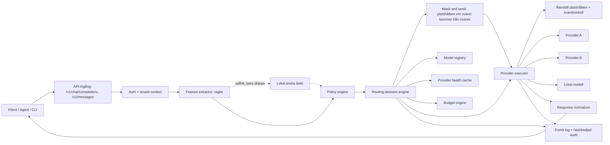

# Systemöversikt

## Översikt

Sluss är en gateway mellan klienter och modellproviders. Den exponerar ett API som klienter redan förstår (OpenAI och Anthropic), läser varje fråga, beslutar vart den får gå och skickar den vidare, eller stoppar den.

**Sluss är inte en nätverksproxy.** Den sitter inte i trafiken och läser inte vad som passerar på nätet. Klienter pekas mot Sluss genom att man ger dem en adress (base URL och nyckel), på samma sätt som man ger dem adressen till en AI-tjänst. De andra vägarna till AI-tjänster stängs av organisationens befintliga verktyg: IdP (t.ex. Entra ID med Conditional Access), MDM (t.ex. Intune) och DNS-filter. Se `manual/one-address.md`.

## Huvudkomponenter

### API-ingång

Tar emot requests i ett format klienter redan förstår: `/v1/chat/completions` (OpenAI) och `/v1/messages` (Anthropic), med streaming och verktygsanrop. Ordet *proxy* används ibland i koden om detta steg; det betyder att Sluss vidarebefordrar ett API-anrop, inte att den sitter i nätverkstrafiken.

### Lokal andra åsikt (valfri)

Av som standard. När `ROUTER_SECOND_OPINION_MODEL` pekar på en lokal rostermodell läser den frågan efter reglerna och får bara lägga till en dataklass, aldrig ta bort. Se `04-routing-engine.md` (Beslutslägen).

### Mask and send

När en matchad regel säger `mask: true` och svaret kommer från en modell som inte är lokal ersätts personuppgifter och nycklar med platshållare före sändning och återställs i svaret.

### Svarskontroll

Varje svar läses med samma värdedetektorer som frågan; det som är nytt i svaret flaggas (request-loggen, audit). Blockerar aldrig.

### Auth och tenant context

Identifierar tenant, projekt, API key, budget och policyversion.

### Feature extractor

Extraherar snabba signaler:

- Promptlängd.
- Förekomst av kod.
- Filnamn och riskabla domäner.
- Taskord som debug, refactor, summarize, commit, migration.
- Kontextstorlek.
- Begärd outputtyp.
- Metadata från headers eller request body.

### Policy engine

Applicerar regler som kan blockera, tvinga, nedgradera, uppgradera eller kräva verifiering.

### Routing decision engine

Scorar kandidatmodeller och väljer primär modell samt fallbackkedja.

### Provider executor

Skickar requesten till vald provider och normaliserar svar, streaming och fel.

### Event log

Sparar beslut, attempt, kostnad, latency, outcome och policyversion.

## Designprinciper

- Fast path ska inte kräva LLM-call.
- Policyn ska vara kompilerad i minne.
- Modellhälsa ska läsas från cache.
- Fallbackkedja ska vara förberäknad innan provideranrop.
- All routning ska kunna förklaras.
- Det ska gå att simulera routing offline.
